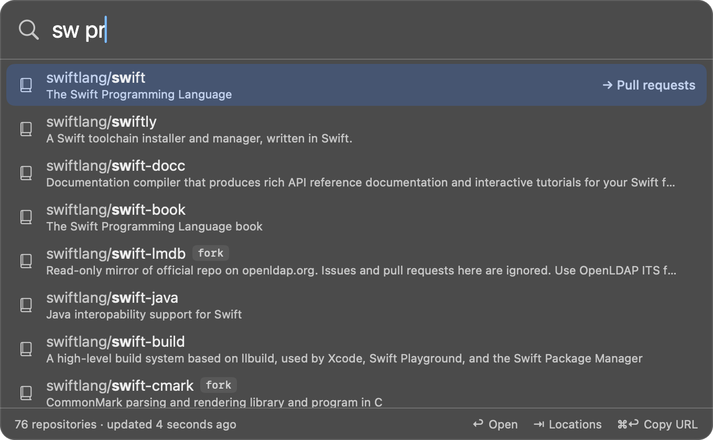

# Locations

A location is a place inside a repository: its pull requests, its Actions
runs, its settings. There are two ways to get to one.

## Inline: add a key after a space

Type the repository, a space, and a location key:



`sw pr` `↩` opens the pull requests of the selected repository. The
selected row shows where Return will go. Arrow keys still choose among the
repositories.

## From a list: press Tab

`⇥` locks the selected repository and lists every location. Type to filter,
`↩` to open, `esc` to go back to the repository search with your query
intact.

## Built-in locations

| Keys | Location | Opens |
| --- | --- | --- |
| `c`, `code`, `home` | Code | the repository's front page |
| `l`, `local`, `clone` | Local folder | the [clone on your disk](local-clones.md) |
| `p`, `pr`, `prs`, `pulls` | Pull requests | `/pulls` |
| `i`, `issues` | Issues | `/issues` |
| `ci`, `build`, `builds` | CI build | the [CI build](#ci-build) of the latest commit |
| `ch`, `checks`, `status` | Checks | the [checks page](#checks) of the latest commit |
| `a`, `actions` | Actions | `/actions` |
| `r`, `rel` | Releases | `/releases` |
| `b` | Branches | `/branches` |
| `co`, `log` | Commits | `/commits` |
| `t` | Tags | `/tags` |
| `s` | Settings | `/settings` |
| `w` | Wiki | `/wiki` |
| `d` | Discussions | `/discussions` |
| `pj` | Projects | `/projects` |
| `se`, `sec` | Security | `/security` |
| `in`, `pulse` | Insights | `/pulse` |
| `mp`, `my` | My pull requests | open pull requests you authored |
| `np`, `compare` | New pull request | `/compare` |
| `ni` | New issue | `/issues/new` |

## CI build

`api ci↩` opens the CI build of the latest commit on the default branch.
When you press Return, Reponomi asks GitHub for that commit and for the
statuses and check runs reported on it, then follows the link of:

1. the first that failed, or
2. if none failed, the first still running, or
3. otherwise the first one.

Commit statuses come before check runs. Most CI services outside GitHub
(Jenkins, TeamCity, CircleCI, Buildkite…) report a status. The build opens
a moment after the panel closes.

### Which links it follows

Anyone who can post a status on the repository chooses its link, so the
link is only followed if it is HTTPS and on:

- the repository's own GitHub host, which covers GitHub Actions, or
- a host listed in [`ciHosts`](configuration.md#ci-hosts) in the config file.

```json
"ciHosts": ["ci.example.com", "app.circleci.com"]
```

Otherwise, and whenever there's no check with a link, you get the
[checks page](#checks) instead.

## Checks

`api ch↩` opens the checks page of the latest commit on the default branch.
It lists the check runs reported for that commit, from GitHub Actions or
other CI services, each with a link to its build.

The page needs the commit's hash, so Reponomi asks GitHub for it when you
press Return. If the token isn't allowed to read the repository's code (a
fine-grained token with only Metadata access), the commit's own page opens
instead, where the commit's checks and statuses are behind the status icon
next to the commit. The same goes for `ci`.

## How a location is chosen from what you type

1. A key that matches exactly wins: `p` is always Pull requests.
2. Otherwise, a key that starts with what you typed: `pu` finds `pulls`.
3. Otherwise, the location names are searched the same fuzzy way as
   repositories: `sett` finds Settings, `disc` Discussions.

If nothing matches, the row says so and Return does nothing.

## Adding your own

Custom locations go in the [config file](configuration.md#custom-locations):

```json
"customLocations": [
  { "name": "Deployments", "path": "/deployments", "keys": ["dp"] },
  { "name": "Docs folder", "path": "/tree/{branch}/docs", "keys": ["docs"] }
]
```

- `path` is appended to the repository's URL.
- `{branch}` is replaced by the repository's default branch.
- `{sha}` is replaced by the latest commit on the default branch, looked up
  when you press Return, as for [Checks](#checks). If the lookup fails,
  nothing opens.
- `keys` are optional; without them the location is still found by name.
- Custom locations are listed and matched ahead of the built-in ones, so
  giving one the key `d` takes `d` over from Discussions.

Restart the app after editing the file.
